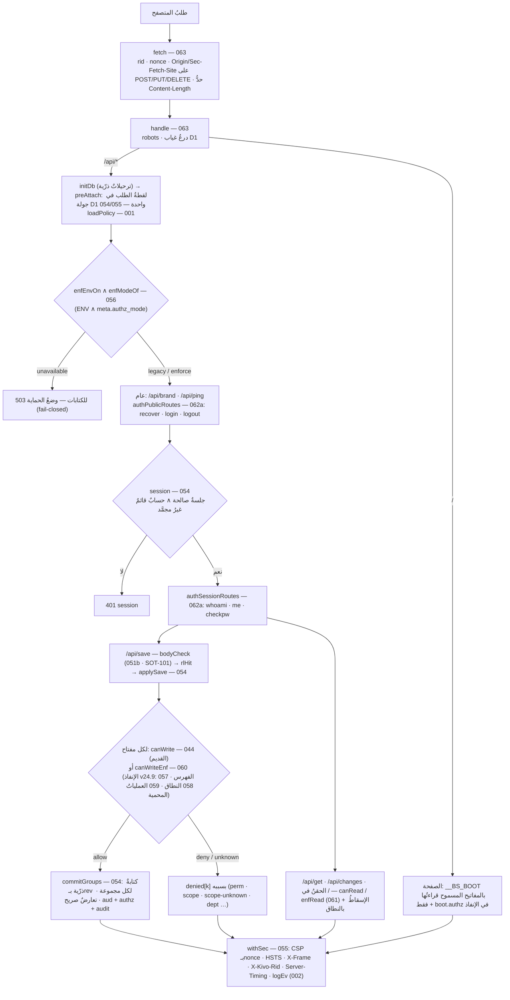
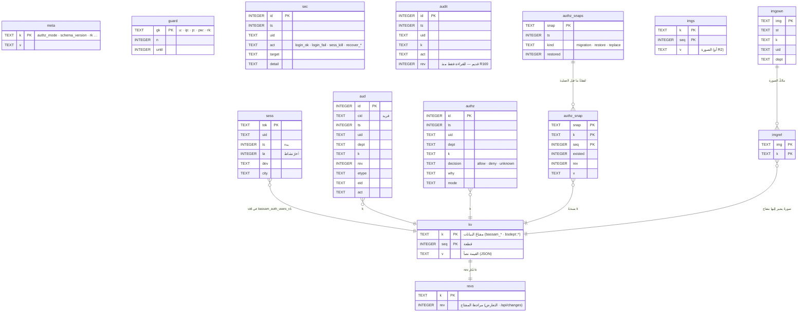

# KIVO — المعمارية (KIVO_263) — تُحدَّث مع كل مرشّح

> وثيقةُ الدخول الواحدة (SOT-158): من هنا إلى التفاصيل — القراراتُ في `docs/adr/` (21) · العقودُ في `docs/api.md` و`src/api/contracts.json` ·
> الأمنُ في `docs/security.md` و`docs/threat-model.md` · الاختباراتُ في `docs/testing.md` · التتبّعُ في `docs/traceability.md`.

## البيئات
- **Cloudflare Pages** بالوضع المتقدّم (`_worker.js`) + **D1** + **R2** للصور (اختياري). بيئتان في المشروع نفسِه:
  Production (`kivo-d81.pages.dev` · قاعدة `bassam-db` · **KIVO_242** — لا تُمسّ قبل الاعتماد النهائي) وPreview (`test.kivo-d81.pages.dev` ·
  `bassam-db-preview` · `KIVO_AUTHZ_MODE=enforce` · `KIVO_TEST_FIXTURE=allow` · `KIVO_TEST_HOST`). وضعُ التفويض الفعلي في القاعدة (`meta.authz_mode`:
  `enforce` مثبت على Preview؛ راجع Playbook لدليل النشر الحالي). الإعداداتُ: `docs/config.md` · `config/env.schema.json` · `config/wrangler.toml` (بلا أسرار).
- **البيانات** (`migrations/*.sql` · ADR-011): `kv(k, seq, v)` كتلُ JSON مقسَّمة بمراجعات `revs` · `imgs/imgown/imgref` الصور · `meta` (السياسات · الوضع ·
  المفاتيح) · `sess` الجلسات · `guard` الحرّاس · `sec` سجلُّ الأمن · `aud` سجلُّ الأنشطة (إلحاقٌ فقط) · `authz/authz_snap/authz_snaps` قراراتُ الإنفاذ ونسخُها ·
  `d1_migrations`. الحدود: 8 MB للحفظة الواحدة · سقفُ الحفظ لكل حساب في الدقيقة (سياسة `wrMin`).

## المستودع (ADR-020 · AUD-029)
**الرسمي 15 مدخلاً** — `src` · `workers` · `public` · `migrations` · `config` · `tools` · `tests` · `docs` · `.github` · `package.json` · `package-lock.json` ·
`README.md` · `CHANGELOG.md` · `eslint.config.mjs` · `.gitignore`؛ `python3 tools/export_official.py --check` يصدّرها وحدها ويُثبت كفايتها (المولِّد · البناء ·
اختباراتُ الوحدة كلُّها · الفحوصُ المعمارية · SBOM · مرجعُ SOT). **المختبرُ الانتقالي** (`cfbench/` حزمُ التكامل والمتصفح · `gateall2NN.sh` · `k242/`…`k250/` ·
`registry*/` مولِّداتُ أجيال السجلّ · `pk*/` · `reports/`) للتاريخ والبراهين.

## المصدر (`src/` · ADR-012) والمشتقّات
| المجلد | ما فيه |
|---|---|
| `core/` | `005-kivo-ns` (الواجهةُ العامة `window.KIVO`: 106 أسماء موصِّلاتٍ غيرِ قابلةٍ للعدّ — ADR-017 · AUD-016) · React 18.3.1 (مورَّد) · محمّلُ الصفحات · `050-dc-runtime` (وقتُ تشغيل القوالب — ADR-008) · الإصدار · السمة |
| `layouts/` | الغلاف (`index.template.html`) و`root-logic.js` (الهيكل · التوجيه `#/<page>/<tab>` · التبويبات · الاستعادة) |
| `components/` | مكوّناتٌ مشتركة: التلميحات · الإتاحة · القوائم · الحوارات · `565-page-kit` (مزيجاتُ الصفحات — ADR-016) |
| `services/` | منصّية (التخزين · الصور · العدّ · السجل · الهوية · `566-print-core` نواةُ الطباعة — ADR-017 · xlsx) ومجالية (الورديات · الأبواب · الجولات · رصدُ الميدان · بياناتُ الموظف · الاستيرادان · قواعدُ التنبيهات) |
| `auth/` · `permissions/` · `scope/` | المصادقةُ في الواجهة · نموذجُ الصلاحيات (330/331 · شجرةُ v24.9 وسقفُ الإدارة — ADR-015) · السجلُّ `registry/registry-v24.9.json` → `340-registry-v24-9.js` |
| `api/` | طبقةُ الخادم في الواجهة (`280-server-storage` · المزامنة) و`contracts.json` (68 مساراً = العامل حرفاً) |
| `manifests/` | `pages.json` (سجلُّ الصفحات الواحد → `KIVO_MANIFEST` · `PG_REG` — AUD-015) · `perm-tree24.json` |
| `plugins/lenses/<key>/manifest.json` | العدساتُ الستّ إضافات (ADR-018 · AUD-030): المفاتيح · الموارد · الحرّاس · الاختبارات → `LENS_REG` في الواجهة و`KIVO_LENS_PLUGINS` في الخادم |
| `modules/<page>/` | 14 صفحة × أربعة ملفات (`logic.js` نموذجُ العرض · `view.html` · `helmet.css` · `meta.json` — ADR-019) → `pages/*.dc.html` (مولَّدة · مصغَّرة) |
| `styles/` (+`tokens/tokens.json`) | طبقتا الرموز (AUD-017): 662 بدائياً → 428 دلالياً؛ 1,352 اسماً حرفياً أسماءٌ مستعارة على الدلالية؛ الداكنُ على الدلالية وحدها → `070/080` |
| `assets/` · `i18n/` · `schemas/` · `types/` | الخطوط والصور والأيقونات (فهرسٌ واحد) · الأرقام العربية والتقويم · مخطّطاتُ JSON · `kivo.d.ts` (الكيانات · الموارد · المسارات · الصفحات · الأسماء — مولَّد) |

`tools/generate.py` يولّد **21 ملفاً مشتقاً** (الصفحات · السجلّ للواجهة والخادم · `_worker.js` من `workers/parts/*` (66 جزءاً) · الترحيلات · الإضافات ·
البيانات الموحَّدة) ويحرسها `--check`؛ و`tools/kivo_ns.mjs` · `tools/tokens.py` · `tools/plugins.py` · `tools/gen_types.mjs` كلٌّ بـ`--check`.

## البناء (`tools/build.py` · `tools/build_chain.sh`)
حتميٌّ بايتاً: `split` (الغلاف + 69 سكربتاً و10 أوراق مبصومةً بالمحتوى + صفحاتٌ كسولة `*.dc.txt` + منطقٌ مُصرَّف `*.logic.<hash>.js`) و`monolith`
(ملفٌّ واحد للمعاينة). كتلُ js تُصغَّر **حافظةً للرموز** (`tools/jsmin_tokens.mjs` · AUD-024 — البرهانُ مدمَج: تيّارُ الرموز = الأصل). **نافذةُ الإصدارين**:
أصولُ آخر إصدارين منشورَين (`--retain` في `build:N` — لـ259: 255 و254) تبقى للتبويبات المفتوحة. `build_chain.sh N` يبني المُبقاةَ من وسوم git إن غابت.

## الخادم (`_worker.js` ≈ 1.2 MB · ADR-006/009)
`fetch` (معرّفُ الطلب · Origin/Sec-Fetch-Site على الكتابات · حدودُ الجسم) → `handle` (68 مساراً `/api/*` + `/api/img/` + الصفحة `/` بحقن `__BS_BOOT`)
→ `withSec` (CSP بـnonce لكل طلب بلا unsafe-inline/eval للسكربت · HSTS · X-Frame · `X-Kivo-Rid` · `Server-Timing`). الطبقات: **المصادقة** (PBKDF2 ·
الجلسات بمدة وخمول · الحرّاس والقفل · AUD-033: البصماتُ لا تغادر الخادم) · **التفويض** القديم (page:act) و**الإنفاذ** v24.9 (deny > unknown > allow ·
مشروطٌ بـENV ∧ `meta.authz_mode` · fail-closed · ADR-002/003 · الوحداتُ المرجعية 004–016 مولَّدةٌ من registry10 ومثبَّتة بايتاً) · **النطاق** (`KIVO_SCOPE`)
· **الحفظ** (`/api/save {set, del, base}` بمراجعات `rev` وتعارضاتٍ صريحة) · **الصور** (D1 أو R2) · **السجلّات** (`sec` · `aud` · `authz`) · **الترحيلات**
(`migrateDb` ذرّيّة) · **السجلُّ المنظَّم** (`logEv` v1 بلا PII · ADR-013).

## الواجهة
React 18.3.1 مضمَّن · dc-runtime يحمّل الصفحاتِ كسولاً وينفّذ منطقَها المُصرَّف (بلا eval — AUD-008) · `root-logic` الهيكلُ والتوجيه · الواجهةُ العامة
`window.KIVO` (القابلُ للعدّ المضافُ إلى window ثلاثة: React · ReactDOM · `__BS_BOOT`) · طبقةُ التخزين تزامن مفاتيح localStorage المسموحة مع الخادم
(قائمةُ بادئاتٍ مسموحة — AUD-003) · السمةُ الفاتحة/الداكنة برموز CSS · الأرقامُ العربية والتقويمُ الهجري · الطباعةُ من نواةٍ واحدة.

## التدفّقات الرئيسة
1. **الدخول**: `/api/login` → حارسُ المحاولات → PBKDF2 → جلسة `sess` + كوكي `bs_tok` (HttpOnly) → `/` يحقن `__BS_BOOT` (المفاتيحُ المسموحُ قراءتُها بالنطاق).
2. **الحفظ**: الواجهةُ تجمع التغييرات → `/api/save` → التفويضُ لكل مفتاح (القديم + الإنفاذ) → تطبيقٌ ذرّي مع `rev` → `aud`/`authz` → المقبولُ والمرفوض.
3. **الإنفاذ**: `KIVO_AUTHZ_MODE=enforce` ∧ `meta.authz_mode=enforce` ⇒ القرارُ من السجلّ v24.9 وشجرةُ صلاحيات الموظف وسقفُ الإدارة؛ تعذّرُ قراءة meta ⇒
   `unavailable` (503 للكتابات) لا سقوطَ إلى القديم. الإيقافُ الفوري بلا نشر: `UPDATE meta SET v='legacy' WHERE k='authz_mode'`.
4. **الترحيل**: يتحقق كل طلب من إصدار المخطط وسجل الترحيلات وحقبة الاستعادة داخل حارس D1. ترقية قاعدة قائمة تتطلب تصريح المشغل الصريح المحدود بالإصدار والوقت؛ العامل الأقدم يرفض قاعدة أحدث حتى بعد التهيئة الدافئة. كل ترحيل دفعة ذرية (`docs/runbooks/migrations.md`).

## مخطّطُ تدفّق الطلب (KIVO_263 · SOT-158) — المواضعُ بأسماء الأجزاء والدوال

## مخطّطُ البيانات (D1 · `migrations/0001_baseline.sql` وما بعده)

> سجلُّ النطاق القديم `bsdept:<d>:bassam_scope_v1` تقاعد (RISHAD-266): لا يقرؤه الإنفاذ ولا يُكتب (`scope-retired`)، وتحذفه خطوةُ `scope-retire`؛
> ولقطاتُ الترحيل/الاستعادة في `authz_snaps`/`authz_snap` (الرجوعُ بـ`/api/authz-migrate?act=rollback`).

## قواعدُ الاعتماد بين الطبقات (SOT-091 · `tools/deps_check.py` — في `npm run lint:deps` والبوابة)
- **R1** `core` لا يشير إلا إلى `core` وبنية الخادم (`api`). إشاراتُ الإبطال (`__dcWorld` · `__dcWrite` · `__dcKeyVer`) ملكُه.
- **R2** الغلافُ والموجِّه لا يشير إلى خدمةٍ مجالية ولا إلى وحدة صفحة إلا عبر **العقود** (`__ADMIN_OPEN_TAB` · `__ADMIN_OPEN_DTAB` · `__BS_OPEN_TAB`)
  و**الواجهات** (`BassamNotif`). **R3** الخدماتُ والمكوّناتُ والصلاحياتُ والمصادقة لا تشير إلى وحدات الصفحات إلا عبر العقود.
  **R4** الخدماتُ المنصّية لا تشير إلى خدمةٍ مجالية.

## الجودة
اختباراتُ الوحدة (العاملُ داخل Node فوق D1 بديل · `tests/unit` — أعدادُها الحالية في `docs/testing.md` المولَّد من آخر جولة بوابة · KIVO_261: الأرقامُ لا تُكتب هنا يدوياً كي لا تتقادم) · براهينُ المصدر لكل مرشّح (الفرقُ المعلن بالبصمات · التكافؤ · الخصوصية — `tests/source/`)
· البوابةُ الكاملة في المختبر (حزمُ Miniflare/Playwright · قابلةٌ للاستئناف · عددُها في سجلّ آخر جولة `reports/k2NN/gate_*`) · السقّاطات (ESLint · ألوانٌ خام · catch فارغ في الواجهة / 0 في الخادم — خطوطُ أساسها في `tests/baselines/`
· نقاطُ الكسر · اللمس · الإتاحة · البصري) · ميزانياتُ الأداء · SBOM · مخطّطُ البيئة · كتالوجُ الاختبارات ومصفوفةُ التتبّع مولَّدان · CI (`.github/workflows/ci.yml`).

## الهدف (SOT TREE) — الحالة في KIVO_259
| الطبقة | الحالة |
|---|---|
| Edge/Worker (`workers/`) | الأجزاءُ مصدرُ الحقيقة (66) والعاملُ مولَّد؛ التقسيمُ إلى ES modules لاحقاً |
| Core · Layouts · Components · Services | مكتملٌ بنيوياً (AUD-010/012/016 · قواعدُ الاعتماد R1–R4 بلا مخالفة) |
| Permissions · Scope · Manifests · Plugins | السجلُّ والشجرةُ والسقفُ من مصدرٍ واحد؛ الصفحاتُ والعدساتُ بسجلّاتٍ تُولِّد كلَّ ما سواها (AUD-015 · AUD-030) |
| Modules | مصدرٌ مقروءٌ بأربعة ملفات لكل صفحة (AUD-007 · ADR-019)؛ الأسماءُ المحلية القصيرة الموروثة من التصغير الأصلي تُعاد تدريجياً |
| Styles · Assets | طبقتا الرموز (AUD-017) · فهرسُ أيقوناتٍ واحد |
| Data | ترحيلاتٌ مرقَّمة · مخطّطُ البيئة · بياناتُ اختبارٍ حتمية (`tests/fixtures/`) |
| Quality | الوحدةُ والبراهين في الرسمي؛ التكاملُ والمتصفح والأجهزة في المختبر (`cfbench/`) — نقلُها إلى `tests/integration|e2e` لاحقاً |

مبادئُ الانتقال (ADR-006): كلُّ خطوة تمرّ بالبوابة الكاملة أو ببرهان تساوي الناتج قبل الدمج؛ الخادمُ هو الحكم؛ KIVO_242 أساسُ Production المجمَّد.

## انتقال البيانات المثبت في RISHAD266

Preview المثبت على المخطط7 ينقل الإحصاءات والتنبيهات والعهدة إلى جداول D1 ويستخدم مترجم استعادة ذريًا مشتركًا. الحسابات وبقية مجالات الأعمال ما زالتKV/JSON؛ لا يُدعى اكتمال تحويلها. مرشح المخطط8 المحلي يضيف خمس جداول للاستـرشاد مع سجل الطلبات، ويعيد استخدام الإنفاذ والعدسات والمترجم ذاته. تُسجل نتيجة قبول النشر الحي في `RISHAD266_PLAYBOOK.md`.

الواجهة تقرأ صفحات السجلات والتجميعات من SQL بدل سحب سجل الاسترشاد كاملًا. الحفظ يحتفظ بالمسودة حتى ACK ويتحقق من المراجعات وحقبة الاستعادة والهوية، مع بيانات وتدقيق وإشعار وإيصال في دفعة واحدة. التصدير الشامل وحده يجمع المجال المنظم للنسخ. المصادر التشغيلية المتقاعدة مرفوضة في الحفظ والإقلاع والقراءة، ويُزال اعتمادها من الوحدة ومراقب التنبيهات. نظام الوحدات والصلاحيات وملفاتManifest والعدسات الحالي محفوظ؛ لا تنفيذ لتصورالإضافات المؤجل.
